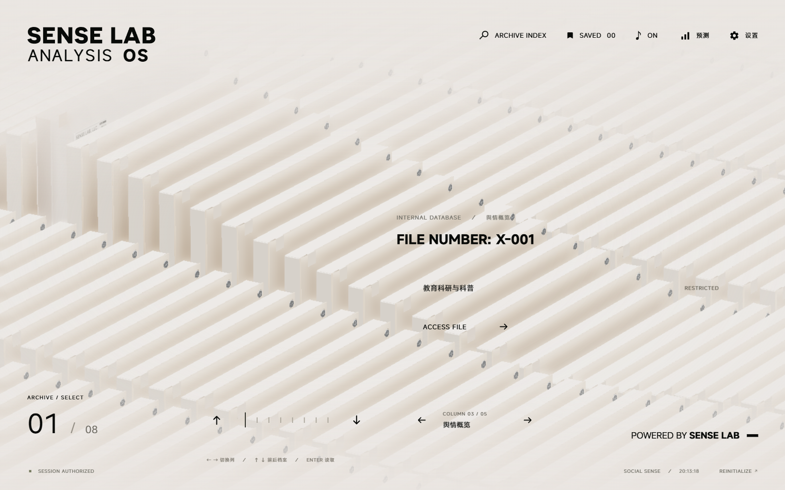
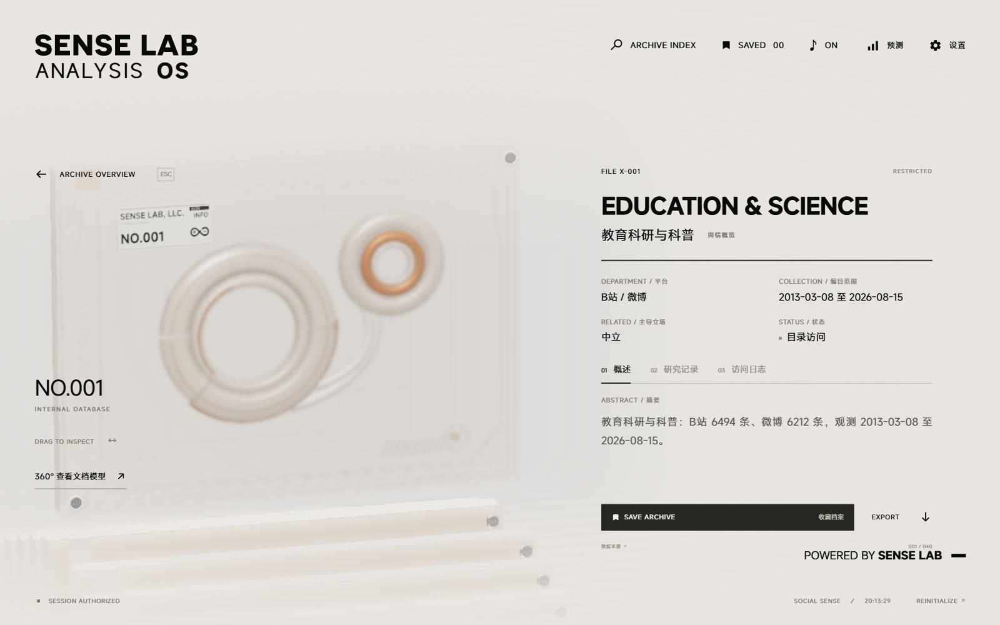
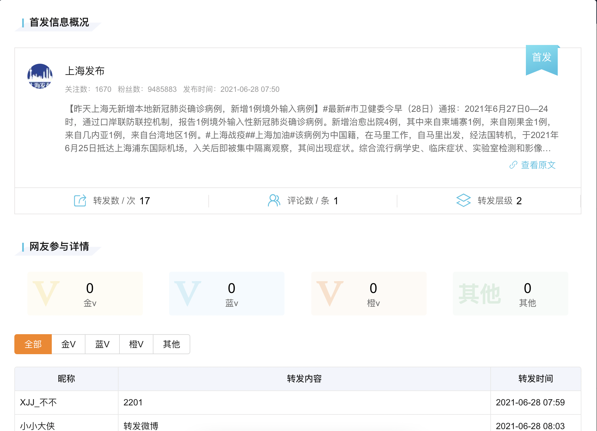

# community_value_20261030_20261030_184037

- Source: `community_value_20261030_20261030_184037.pptx`
- Total slides: 18

## Slide 1

创新训练类中期答辩

SocialSense
基于多源社交媒体协同的
舆情溯源与辅助预测系统

汇报人：张艺嘉

指导教师：树杨

成员：詹江叶煜 郑锦凡 王悦 吴珂欣

2026 年 11 月

### Speaker Notes

各位老师好，我是张艺嘉。SocialSense围绕多源舆情开展证据分析、传播研究与辅助预测，下面汇报创新训练项目的中期进展。

## Slide 2

研究价值：从舆情监测走向社区互动

以游戏梗文化为切入点：理解积极传播，连接创作来源、玩家表达与官方回应

让积极内容被理解与看见

01

角色、台词与共同经历被转化为可复用的表达，
降低交流门槛，带动二次创作与圈层传播。
分析对象因此应包含内容来源、变体和互动反馈。

让官方回应更有依据

02

在转发、认可或使用玩家创作前，需要核对原始
语境、作者与改编链，区分友好调侃和真实不满；
这些信息可为素材支持、互动回应提供参考。

让社区维护兼顾参与和信任

03

保留出处、解释立场差异，有助于呈现真实诉求、
认可创作者贡献，并减少脱离语境的误判。
正向互动的收益仍需试用与对照评估来验证。

[\[W2\] TapTap 创作征集活动原图](https://www.taptap.cn/moment/832223722998859956)

[\[W1\] 官方素材分享](https://www.taptap.cn/moment/834126362733185189)

公开案例说明应用需求，不代表已验证的传播增益

公开案例：征集二创、攻略与体验分享

SocialSense · 创新训练类中期答辩

02 / 18

### Speaker Notes

我们希望关注舆情的积极价值。游戏梗把角色、台词和共同经历变成交流语言，既带动二创，也连接玩家和官方。右侧创作征集，以及官方主动分享素材的公开记录，说明这种互动有具体场景。对项目而言，关键是帮助看清内容出处、玩家诉求与平台差异，为创作认可和社区沟通提供依据。参与增长等收益，则需要后续试用验证。

## Slide 3

为什么需要溯源：从热梗流转到创作认可

同一主题会被改写、拼接和跨平台转发；回应前需要可核查的出处与语境

追溯来源：找到可核查的原始表达

01

区分活动素材、玩家原创与后续搬运；保存作者、
发布时间和原链接，避免把最早采集误当真正首发。

梳理传播：把内容变体放回关系链

02

记录引用、改写与转发线索，比较平台扩散顺序；
同源识别与传播图是后续重点，时间相关不等于因果。

辅助回应：看见创作者与玩家诉求

03

将出处、上下文与立场差异整理为可审阅档案，
为素材支持、创作认可和社区答疑提供决策依据。

评价反馈：观察互动与社区交流

04

固定窗口比较二创参与、反馈质量和误读案例；
控制版本活动等因素，避免把热度上涨归因于回应。

[\[W1\] 官方公开素材图（完整比例）](https://www.taptap.cn/moment/834126362733185189)

[\[W2\] 征集要求原创首发](https://www.taptap.cn/moment/832223722998859956)

[\[W5\] 同源梗与跨社区传播研究](https://arxiv.org/abs/1805.12512)

SocialSense · 创新训练类中期答辩

03 / 18

### Speaker Notes

以这个案例为例，技术任务可以展开成四步：先核对原始表达与创作者，再梳理改写、引用和转发关系，随后把语境与立场整理为可复核档案，最后观察回应后的交流。征集规则要求原创首发，也说明来源核验有现实需要。最早采集不等于真正首发，热度上涨也不等于回应有效。当前同源识别与完整传播关系仍是后续研究重点。

## Slide 4

技术如何承接：统一证据，再关联传播

当前代码以 PlatformReport 连接单平台分析、跨平台比较与交互展示

② PlatformReport 数据契约

① 单平台观测

⑤ 服务与交互

结论 · 时序 · 元数据 · 引用

采集清洗与立场画像
文本、时序及检索补充
保留来源标识和元数据

Flask API 与三维档案
组织范围、摘要和记录
旁路接入数值预测结果

③ 时间对齐与差异融合

保留缺失；比较立场、情绪和声量

已有价值

面向人工复核

④ 跨平台主控与 CX 校准

将零散观测变为统一报告，
为后续证据核查提供接口。

帮助研究者回看观测依据，
再判断是否适合官方回应。

把汇总结论绑定到具体平台证据

面向梗溯源的后续衔接

增加内容变体标注、原始链接与引用关系，再验证首发候选和传播链；现有时间对齐不等于语义同源识别。

代码定位：multiagent/contract.py · align.py · fuse.py；完整图传播溯源尚待验证。

SocialSense · 创新训练类中期答辩

04 / 18

### Speaker Notes

这些需求如何落到代码？我们已经以统一的平台报告契约组织单平台结论、时序和来源信息，再做时间对齐与差异融合，经跨平台规则形成汇总。后端和档案界面承接查看，预测模块提供旁路结果。它为来源核查建立了数据与报告基础；面向梗的变体标注和引用边还需补充，当前时间对齐不能代替同源识别。

## Slide 5

支持正向互动，先让结论经得起复核

“笑飞了”可能是赞赏，也可能是反讽；识别表达对象和语境，才能减少回应误判

G1—G7：单平台结论与观测一致

原句、上下文与来源

核对趋势、情绪、立场、引用标识、数值边界，
检查空窗表述以及风险判断是否有观测依据。
它能暴露结构性矛盾，不等于理解全部梗义与反讽。

形成候选态度判断

CX1—CX5：跨平台汇总不掩盖分歧

规则核验与受限改写

核对平台覆盖、分歧表述和引用平台的有效性，
每条断言绑定平台；全空数据不生成强结论。
引用存在不代表内容支持结论，仍须回看原文。

保留依据与不确定性

目的：减少脱离语境的强判断

应用意义：让社区团队看见不同声音，保留可复核的回应依据。

SocialSense · 创新训练类中期答辩

05 / 18

### Speaker Notes

正向互动同样需要谨慎理解语境。例如“笑飞了”可能是赞赏，也可能是反讽。单平台规则核对结论与观测是否一致，跨平台规则保留分歧并绑定引用平台。这样能暴露不一致，让社区团队回看依据；但引用标识存在不代表内容足以支持结论，规则也不能证明模型读懂了梗。关键含义与出处仍要人工复核。

## Slide 6

热度预测：区分长期积累与突然走红

四分量是建模假设；不把热度上涨直接解释为官方回应的因果效果

按结构分别编码

输入热度 x

线性 / PatchCNN / 稀疏事件 / 轻量 SSM；
分别处理趋势、周期、冲击和其余波动。

x = T + S + C + R

四路数值表征参与路由

T 趋势

S 季节

C 冲击

R 剩余

默认 top-k = 2 进行专家选择；
融合权重是否有效，需要消融实验验证。

EMA

Fourier

事件信号

代数剩余项

文本增量是可选路径

四路编码 → 稀疏专家融合

完整模型有门控文本分支；现有部署验证
关闭文本，不能推断已读懂游戏梗与图像。

预测增量 → 累加回水平域

过去 28 天 → 未来 6 天

预测与传播解释分别评价

研究用途：辅助观察话题是否持续，
为后续复核和社区互动研究安排时间窗。

下页为既有数据实测，不是方舟社区实验；
跨话题泛化及回应效果仍需独立评估。

SocialSense · 创新训练类中期答辩

06 / 18

### Speaker Notes

预测部分把热度分为趋势、季节、冲击和剩余四路，分别编码，再通过稀疏专家融合，输入过去二十八天，预测未来六天。用梗文化作类比，可以理解为长期积累、周期活跃、突然走红与其余波动；这只是建模假设，不是因果解释。它旨在辅助安排观察窗口。完整模型还有可选文本分支，现有验证关闭文本，下页也不是方舟社区的实验。

## Slide 7

实测结果：数值拟合与预警仍有提升空间

2026-10-19 CPU 数值路径验证；测试窗口 262 个

65.53%

标准化 log1p 空间 MSE

方向准确率

235 个非平坦窗口

> [Chart] mse-comparison — COLUMN_CLUSTERED (51)

| Category | MSE |
| --- | --- |
| 持续值 | 1.5246421098709106 |
| 数值路径 | 1.8885908126831055 |

0.610

尖峰 AUC

召回率 39.39% / 精确率 38.24%

预警阈值来自验证集，测试集仅用于评估

242.17 KiB

数值包 · 49,373 参数 · 262 窗口一致

文件体积不等于运行内存；重叠窗口不独立

较持续值基线高 23.87% · 误差尚未占优

SocialSense · 创新训练类中期答辩

07 / 18

### Speaker Notes

已有实验中，方向准确率为百分之六十五点五三，尖峰AUC为零点六一，但MSE比持续值基线高约百分之二十三点八七，数值误差尚未占优。固定验证集阈值下，精确率和召回率均不足四成，预警价值还需改进。工程上，约二百四十二KiB的数值包，在二百六十二个测试窗口与原数值路径输出一致；这一结论不包含文本能力。

## Slide 8

交互原型：从档案入口进入研究记录

本地仓库运行实拍 · 2026-10-29 · 内置档案数据

三维档案终端

浏览与检索议题档案
查看平台和观测范围
进入详情与研究记录

该截图证明前端交互已运行。
线上服务及数据链路仍需联调。

SocialSense · 创新训练类中期答辩

08 / 18

### Speaker Notes

这是仓库前端本地运行的真实截图，使用内置档案数据。它已经能组织议题、平台、观测范围和研究记录，便于查看与复核。未来梗案例也可以沿用这种档案组织方式，但图中没有接入方舟社区实测；线上采集、模型服务和报告接口仍需完整联调。

## Slide 9

差异化定位：面向游戏社区的来源与互动研究

比较的是研究切入点；优势需要同口径评价，不预设功能或性能全面领先

成熟产品的公开能力

本项目拟突出的研究切入点

来源与创作认可

新浪舆情通提供监测和预警，已覆盖
微博 / 新闻溯源、传播效果与品牌洞察。
其公开产品也已使用多智能体分析。

追踪同源梗的改写和引用，保留创作者与语境。

立场与互动时机

结合平台分歧和热度，辅助发现参与与误读线索。

差异化需要落实到具体任务的评价：
围绕来源证据、同源变体与复核效率，
检验游戏社区这一垂直场景的研究收益。

回应与反馈评价

关联官方回应和后续互动，检验是否改善交流。

[\[W3\] 官方产品介绍](https://yuqing.sina.com/undefined/about)

[\[W4\] 信息溯源说明](https://files.yqt365.com/fileOnline/instruction.html)

应用展望（后续）

可面向游戏社区团队提供试点工具或专题报告。

先验证溯源质量、语境判断和人工复核效率，再评估服务方式；当前以创新训练和技术验证为主。

SocialSense · 创新训练类中期答辩

09 / 18

### Speaker Notes

竞品比较需要客观：新浪舆情通已有溯源、传播效果和品牌洞察。我们拟突出的方向，是围绕游戏社区把创作来源、平台语境和回应反馈关联起来，优势仍需评价。应用上可探索试点工具或专题报告，先证明来源更准、复核更高效，再讨论服务模式，当前重点仍是创新训练。

## Slide 10

中期进展：四条主线成型，关键验证待补齐

按仓库实现与研究记录报告状态；由五名成员围绕可检查交付物协作

01 数据接入与标准化

02 跨平台分析与校准

已有适配接口、清洗与平台报告契约；
逐平台稳定性和来源元数据仍需核查。

已实现时间对齐、差异汇总及 G/CX 规则；
语义同事件对齐、梗义判断仍需标注样本。

03 辅助预测与部署

04 交互与研究记录

已训练四分量模型，完成 CPU 数值包验证；
误差尚未优于持续值，文本收益和泛化待测。

已有三维档案入口、详情页和运行截图；
线上全链路联调与用户试用待补齐。

成员协作与交付

张艺嘉：架构、模型与联调 · 王悦：数据质量 · 郑锦凡：基线与误差分析

詹江叶煜：事件对齐与传播关系 · 吴珂欣：档案交互 · 共同补齐：样本、评估表和试用记录

当前未形成已验证的完整图溯源成果；正式成果状态以申请回执和验收记录为准。

SocialSense · 创新训练类中期答辩

10 / 18

### Speaker Notes

中期已形成数据、跨平台分析、预测和交互四条原型主线。五名成员围绕架构、数据质量、实验、传播关系和交互协作，以接口、评估表、关系样本和试用记录作为交付物。后半程重点是补验证，尤其是同源识别、传播关系和线上联调。

## Slide 11

下一阶段：把应用价值转化为验证任务

项目周期至 2027 年 6 月；先建立可复核样本，再评价技术收益和使用价值

2026.11—12

2027.01—03

2027.04—06

来源与关系样本

统一实验与试用

互动研究与结题

标注素材、原创、改写与搬运
记录原链接、时点和直接引用
区分首发候选与已核实来源
验收：标注说明、分歧样本集

同源识别、传播关系基线比较
滚动切分、跨话题与分量消融
小规模测量误链接和复核耗时
验收：评估表、误差与试用记录

固定窗口观察二创与反馈质量
记录版本、活动等混杂因素
收敛已验证功能并整理成果
验收：研究报告与正式回执

关键问题：出处是否更准、误读是否减少、人工复核是否更高效；未有可信对照时只报告关联。

申请书预算 7,500 元；实际获批额度、支出和调剂审批待财务记录核对。

优先投入数据验证、必要算力与成果整理，形成科研训练过程和可检查的验收材料。

SocialSense · 创新训练类中期答辩

11 / 18

### Speaker Notes

下一阶段先补齐来源和关系标注，再做统一基线、跨话题评估与小规模试用，最后研究互动反馈并整理结题成果。重点回答出处是否更准、误读是否减少、复核是否更高效。申请预算为七千五百元，实际支出与成果状态以财务凭证和正式回执为准。

## Slide 12

请各位老师指正

已形成研究原型，下一步补齐验证与溯源

汇报人：张艺嘉 · 指导教师：树杨
成员：詹江叶煜 郑锦凡 王悦 吴珂欣

2026 年 11 月 · 进入问答

### Speaker Notes

我们希望把多源舆情技术用于理解社区、支持创作认可和有依据的互动。当前已有研究原型，后续将补齐溯源与效果验证。请各位老师指正。

## Slide 13

备份｜评价协议与误报漏报明细

数值路径：CPU / with_text=False / L=28 / P=6

标签阈值与报警阈值分别定义

数据与时间切分

报警：预测增量 > 验证集阈值 0.4694
标签：真实增量 > 测试集分位数 1.6922

1339 天：2023.01.01—2026.08.31
训练 / 验证 / 测试：937 / 135 / 267 天
测试窗口：262；方向有效窗口：235
仅训练段拟合 log1p 后的标准化器
方向排除真实变化幅度最低 10% 窗口
尖峰标签按测试集真实增量 q75 定义

|   | 真实尖峰 | 真实非尖峰 |
| --- | --- | --- |
| 报警 | 26 | 42 |
| 不报警 | 40 | 154 |

标签用于回溯评价，不是预先已知的尖峰标准。
窗口重叠，后续需滚动评估及分块置信区间。

SocialSense · 创新训练类中期答辩

13 / 18 备份

### Speaker Notes

实验按时间划分训练、验证和测试，标准化器仅在训练段拟合。报警阈值来自验证集预测增量，测试集分位数只用于定义回溯评价标签，二者不能混为一谈。二百六十二个测试窗口中，真正例二十六、假正例四十二、假负例四十、真负例一百五十四；窗口存在重叠，后续还需滚动评估和分块置信区间。

## Slide 14

备份｜文献启发与当前实现的边界

文献支持研究设计，不自动构成本项目的性能证据

DLinear / xPatch [3,4]

已实现 ≠ 已证明

分解、线性基线与 PatchCNN；项目扩展四分量路径。

框架与代码可检查
相对性能仍需统一基线
回音室需互动网络证据 [1]

Mamba / PELT [5,6]

选择性状态与变点建模；项目采用轻量实现与事件信号。

RAG / ReAct [7,10]

待完成的验证

外部证据与行动反馈；项目以契约和规则约束生成。

分量 / 文本 / 路由消融
跨话题与滚动时间评估
传播关系与标注样本 [2]

Time-LLM 与消融研究 [8,9]

文本或大模型的价值必须独立消融，不能先验假定。

SocialSense · 创新训练类中期答辩

14 / 18 备份

### Speaker Notes

我们从分解预测研究中借鉴分量建模，从Mamba借鉴选择性状态思想，从RAG和ReAct借鉴外部证据与行动反馈。项目当前采用轻量实现和规则契约，不能直接引用原论文的性能作为本项目成绩。对文本路径、专家路由和传播解释的价值，需要各自补充消融与人工标注检验。

## Slide 15

备份｜详情界面保留来源与观测范围

本地运行实拍 · 仓库内置档案数据 · 非线上实时抓取证明

可检查的入口

平台 / 来源
观测时间范围
摘要与主导立场
研究记录与访问日志
截图内条数属于该档案，
不等于预测实验样本量。

SocialSense · 创新训练类中期答辩

15 / 18 备份

### Speaker Notes

详情页显示平台、观测范围、摘要、立场以及研究记录入口。该页面来自仓库本地运行的内置档案，其中展示的条数属于该档案，不能替代预测实验的一千三百三十九个日度观测口径。下一步需将界面字段与后端证据索引逐项核对。

## Slide 16

备份｜经费按申请预算列示，实支待核账

材料依据：立项申请书预算；原草稿调整建议尚缺审批与票据

| 原预算科目 | 金额 / 元 |
| --- | --- |
| 云服务器 | 1,800 |
| 数据采集与接口 | 1,200 |
| 软件开发与模型训练 | 2,000 |
| 大模型调用 | 1,000 |
| 调研差旅 | 800 |
| 知识产权及论文 | 700 |
| 合计 | 7,500 |

下一步核对

获批额度与实际到账
逐笔支出、账单和凭证编号
预算科目与调剂审批
原草稿提出调用费增至 2200 元，
目前仅按调整建议记录。
不据此计算执行率与结余。

SocialSense · 创新训练类中期答辩

16 / 18 备份

### Speaker Notes

这里列示的是立项申请书的六类预算，总额七千五百元。原草稿提出的费用调剂目前按建议记录，尚缺审批与支出票据，因此不把预算等同于实际花费。负责人将按实际到账、逐笔支出、凭证和调整审批完善台账。

## Slide 17

备份｜竞品公开能力与差异化验证

溯源已是成熟产品能力；本项目聚焦游戏社区语境，并用样本和实验检验特色

比较边界

公开说明包含首发、参与者和传播路径。
本项目以这些已有能力为参照，重点研究
游戏梗的版本、语境与回应反馈的关联。

差异化如何验证

同源版本：准确率、召回率与误链接率。
来源复核：错误归因、可核查比例与耗时。
回应研究：有效参与、反馈质量与误读例。

文献启发 [11 / W5]

感知哈希、聚类与跨社区传播建模可作基线；
中文游戏梗需单独标注，不能照搬原文效果。

[\[W4\] 舆情通官方说明中的溯源截图](https://files.yqt365.com/fileOnline/instruction.html)

[IMC 2018 · On the Origins of Memes](https://arxiv.org/abs/1805.12512)

历史功能示例（图内为2021年数据），非本项目界面

SocialSense · 创新训练类中期答辩

17 / 18 备份

### Speaker Notes

左侧是舆情通官方说明中的历史功能截图，不是本项目界面。它说明成熟产品已有首发和传播路径分析。我们将通过同源识别、错误归因、复核耗时等指标验证游戏社区方向的价值；回应前后反馈只在控制活动等因素后解释，没有可信对照时只报告关联。新增梗传播论文提供了感知哈希、聚类和跨社区传播建模的参考，但其数据并非中文游戏社区。

## Slide 18

备份｜参考文献与网络证据入口

方法依据覆盖跨平台传播、分量预测和证据约束；论文、网页与图片留痕均保存于仓库

[1] Cinelli et al. (2020, preprint)

[7] Lewis et al. (NeurIPS 2020)

Echo Chambers on Social Media: A comparative
analysis · arXiv:2004.09603

Retrieval-Augmented Generation for
Knowledge-Intensive NLP Tasks · 2005.11401

[2] Zannettou et al. (2017)

[8] Jin et al. (ICLR 2024)

The Web Centipede · arXiv:1705.06947

Time-LLM · arXiv:2310.01728

[3] Zeng et al. (AAAI 2023)

[9] Tan et al. (NeurIPS 2024)

Are Transformers Effective for Time Series
Forecasting? · arXiv:2205.13504

Are Language Models Actually Useful for
Time Series Forecasting? · 2406.16964

[4] Stitsyuk & Choi (2024, preprint)

[10] Yao et al. (ICLR 2023)

xPatch · arXiv:2412.17323

ReAct · arXiv:2210.03629

[5] Gu & Dao (2023, preprint)

[11] Zannettou et al. (IMC 2018)

Mamba · arXiv:2312.00752

On the Origins of Memes by Means of Fringe
Web Communities · arXiv:1805.12512

[6] Killick et al. (2011, preprint)

[W1 官方素材](https://www.taptap.cn/moment/834126362733185189)

[W2 创作征集](https://www.taptap.cn/moment/832223722998859956)

Optimal detection of changepoints with a linear
computational cost · arXiv:1101.1438

[W3 产品介绍](https://yuqing.sina.com/undefined/about)

[W4 溯源说明](https://files.yqt365.com/fileOnline/instruction.html)

[W5 新增论文](https://arxiv.org/abs/1805.12512)

仓库留痕：docs/community_value_20261030/research/SOURCES.md；预测实验与基础文献见 midterm_20261029。

SocialSense · 创新训练类中期答辩

18 / 18 备份

### Speaker Notes

十一篇方法与应用研究文献均留有原文与重点阅读记录，网页配图也有来源和下载记录。文献解释研究设计，不能替代项目自身实验。指定学术检索入口此前访问受限，记录中已如实说明原始论文替代来源及实际阅读范围。
