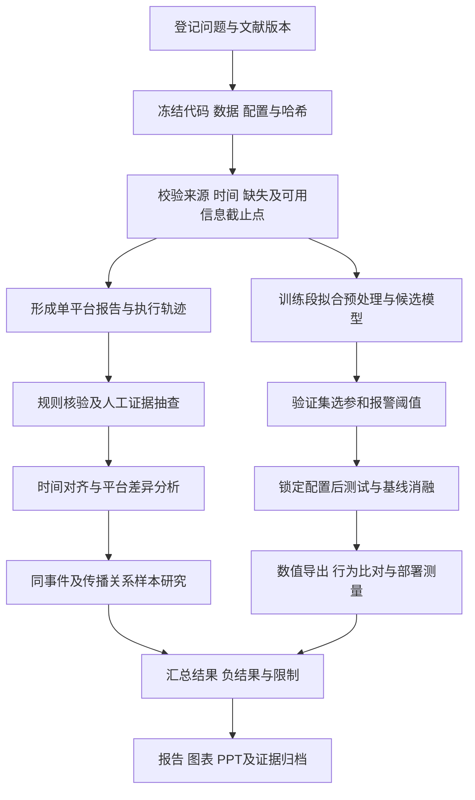

# SocialSense 研究工作流

版本：2026-10-30。本文件把当前实现和下一阶段研究步骤连起来；它是研究操作规范，不是已执行全部步骤的证明。对应文献编号见 `research/READING_NOTES.md`，规则见 `RESEARCH_CONSTRAINTS.md`。

## 1. 研究目标与可证伪问题

| 编号 | 问题 | 当前状态 | 成功或失败怎样判断 |
|---|---|---|---|
| RQ1 | 跨平台数据怎样在不掩盖缺失的前提下比较？ | 时间外连接与平台内标准化已有实现 | 能回查输入平台、日期、缺失比例；人工事件对齐样本证明比较对象一致 |
| RQ2 | 规则与检索能否改善结论证据支持？ | 单平台 G 和跨平台 CX 规则存在 | 在固定反例集与真实抽样上比较支持率、漏拦截及人工一致性 |
| RQ3 | 四分量与专家融合是否优于简单方法？ | 数值模型已验证；MSE 未优于持续值 | 在统一协议、滚动切分和消融下给出效果及不确定性 |
| RQ4 | 文本提供额外信息还是只增加复杂度？ | 有文本路径；数值验证关闭文本 | 与文本停用、时间打乱、无关文本和容量匹配对照比较 |
| RQ5 | 哪些传播线索能够被可靠回查？ | 关系样本与图研究待补齐 | 标注同事件、显式关系、观测首发；报告排序/边/路径指标及证据缺口 |
| RQ6 | 数值交付在目标环境可用吗？ | 指定 CPU 路径输出一致 | 在目标服务器测资源、延迟、异常降级；单列文本功能边界 |

## 2. 总体过程



## 3. 分步操作及产物

### W01 文献与研究问题登记

针对具体代码决策检索支持和反方研究。保留入口、查询、时间、访问失败、版本、重点阅读页、原文链接、PDF 哈希；先完成问题—方法—限制—代码映射，再决定采用何种候选方法。当前以 P01–P10 为种子，Scholar Labs 恢复后补充查询结果，不倒填成功检索记录。

**产物**：检索日志、文献表、阅读笔记、候选假设。**验收**：每个核心设计至少能说明依据与尚未回答的问题。

### W02 冻结实验输入与实际运行环境

为每次实验单独创建目录，记录 Git HEAD、未提交代码差异、数据文件 SHA256、时间范围、行数、字段、依赖版本、设备、线程、种子及命令。源数据只读，派生数据单独保存。不能只记录文件名，因为同名文件可能变化。

**当前参考记录**：`social_forecast/results/retrain_20261019/run_manifest.json`、`deployment_verification.json`。**验收**：数据和配置可唯一定位，后续运行不会覆盖原始结果。

### W03 数据与信息时点校验

核验平台名、事件标识、时间区和采集窗；保留重复、缺失、接口失败、回退数据的标记。缺失不直接变成 0。预测侧检查排序、重复日、target 转换与训练段统计量；文本必须登记发布时间和采集可用时间。

**前视审计**：保持历史片段不变，改变预测起点后的数据，检查起点前特征是否改变；重点覆盖 PELT/事件信号、文本检索、平滑及归一化。此项是待补实验，不能用现有导出等价结果替代。

**产物**：数据卡、缺失表、时间截止点检查、失败样例。**依据**：P02、P06、P08。

### W04 单平台执行与证据核验

按 `agent/agent/orchestrator.py` 的真实流程执行，记录采集、画像、分析、条件检索补充、生成和校准；Skill4 为条件触发，不要求每次都检索。保存输入范围、工具返回、skill_log、候选与最终结论、规则失败和受限改写。

G1–G7 的通过/失败应独立记录；人工抽样验证引用内容是否真正支持判断。规则测试至少覆盖趋势相反、引用不存在、数值越界、空窗强结论、风险证据不足等场景。模型自报“已核验”不能作为通过依据。

**产物**：PlatformReport、claim—evidence 对照、规则覆盖表、人工复核记录。**依据**：P07、P10。

### W05 跨平台比较与事件对齐

先按 `multiagent/align.py` 对齐时间，按 `fuse.py` 计算聚合差异，再执行 `master.py` 的 CX1–CX5。报告平台覆盖、共同观测点和不确定性。

下一阶段另外建立事件标注集：URL 规范化与去重→候选文本匹配→人工同事件/非同事件标注→冲突复核→冻结测试集合。以 precision、recall、F1 和争议比例评价事件对齐，避免仅用几张相似案例证明聚类有效。

**产物**：对齐数据、差异分量表、事件对齐样本及协议。**依据**：P01、P02。聚合差异不称作已证实的回音室。

### W06 预测基线与消融

固定已有 L=28、P=6 作为首轮对照，不在测试集上调参。候选基线：持续值、季节持续值、Linear、DLinear/NLinear；候选消融：移除 C、用简单剩余编码替换 SSM、固定 EMA、均匀融合/单专家/稀疏路由、文本启停。

先保持预测头和信息截止点一致，再改变目标模块；若同时改变多项，应另立实验而非声称单因素贡献。文本的补充对照包括发布时间打乱与无关文本，以区分额外信息和模型容量。

**产物**：配置矩阵、逐窗预测、全指标表、错误案例。**依据**：P03–P06、P08、P09。未运行的单元格写“待执行”，不预估提升值。

### W07 评价与统计解释

按固定训练/验证/测试段报告 MSE/MAE、方向与有效样本数、ROC-AUC、precision/recall/F1 和混淆矩阵。标清标准化 log1p 空间与原量纲，若转回原量纲须使用同一逆变换。

报警阈值在验证集选定并保存；测试分位数若用于回溯标签，应明确其用途和部署不可预知性。补充跨时间滚动与跨话题外部验证；重叠窗口采用按时间块的重采样或其他合理处理，不能把 262 个窗口当成独立事件做简单显著性论证。

**产物**：统一评估表、基线相对差、分块不确定性、逐段表现。报告有利与不利结果。

### W08 传播关系与图方法

先收集可核验的引用、转发、回复、共享 URL 或同事件关系，明确边的类型、方向、时间与证据链接。先测时间排序、度/中心性等简单方法，再按数据规模决定是否引入 Hawkes 或 GNN。

有显式边标注时评价边识别；有关键节点标注时评价 top-k 排序；有路径证据才评价路径一致性。统计领先只能叫“观测领先”，不得自动写作真实首发源或因果影响。数据不足时如实收窄问题。

**产物**：图数据卡、边证据样本、简单基线和错误分析。**依据**：P01、P02。此流程为后续研究，当前不报告已完成 GNN 溯源。

### W09 导出与部署验证

利用已有脚本分别导出数值权重、验证指定推理路径。在具有项目依赖的 Python 环境中，可使用下列命令复核；输出目录应为新建运行目录，脚本拒绝覆盖已有输出：

```powershell
python social_forecast/scripts/verify_forecast_checkpoint.py --checkpoint social_forecast/checkpoints/retrain_20261019/SocialMedia_log_lite_pl6_L28.pt --numeric-checkpoint social_forecast/checkpoints/retrain_20261019/SocialMedia_log_lite_pl6_L28_numeric.pt --output social_forecast/results/midterm_recheck/deployment_verification.json --threads 2
```

这是一条可供后续执行的命令，不表示本次重新执行了该验证。当前材料引用的是已有 2026-10-19 记录。目标服务器另测冷启动/热请求、p50/p95 延迟、峰值内存、并发、缺失输入及网络异常，和权重体积单独报告。

**产物**：导出哈希、等价 JSON、部署测量、异常降级说明。**依据**：P05、P09。

### W10 材料与评审闭环

每个图表绑定结果文件，每条完成声明绑定代码或回执。以“问题—方法—结果—局限—下一步”组织报告；将详细协议放入问答备份，不塞满主讲页。

PPT 沿用已确认模板映射，修改后刷新 authoring summary，执行 ppt-master 质量检查、原生导出、delivery check、文字回读及 Office 渲染。Word 保持原官方表格与字数限制，渲染后逐页检查标题、断行与表格。证据变更时同步更新表、PPT、讲稿和索引。

**产物**：DOCX/PDF、PPTX/PDF、讲稿、证据映射及 QA。**验收**：数字一致、未完成事项明确、主讲节奏 360 秒计划可排练。

## 4. 下一阶段优先顺序

1. 先补数据与前视审计、简单基线、统一指标，解释现有负结果。
2. 再做分量/路由/文本消融与滚动评估；以证据决定保留哪些复杂模块。
3. 并行整理事件标注和传播关系样本；在样本可核查之后推进图方法。
4. 完成目标环境测量、线上联调与小规模用户试用；最后整理成果回执及经费台账。

建议分工沿用汇报表：张艺嘉统筹与交付；郑锦凡评估；王悦数据；詹江叶煜传播与事件对齐；吴珂欣交互与联调。验收材料形成前统一标记“进行中/待执行”。
