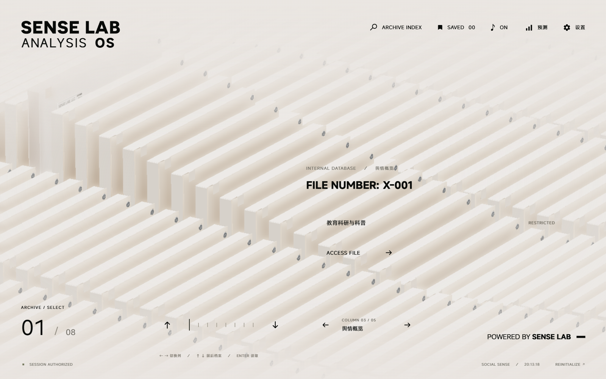
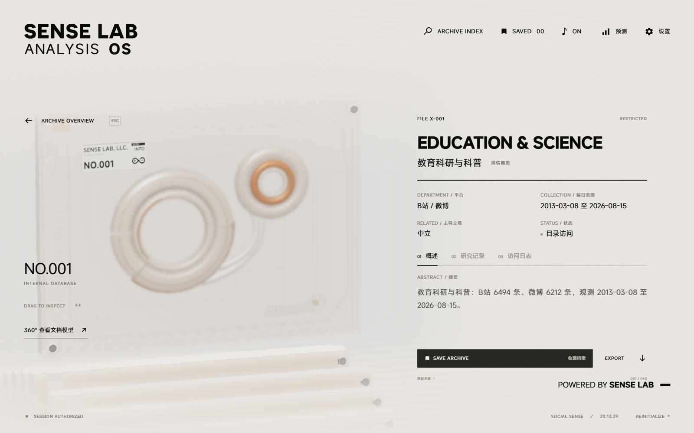

# presentation_20261030_015340_native_charts_tables_manual

- Source: `presentation_20261030_015340_native_charts_tables_manual.pptx`
- Total slides: 18

## Slide 1

创新训练类中期答辩

SocialSense
基于多源社交媒体协同的
舆情溯源与辅助预测系统

汇报人：张艺嘉

指导教师：树杨

成员：詹江叶煜 郑锦凡 王悦 吴珂欣

2026 年 11 月

### Speaker Notes

各位老师好，我是张艺嘉。我们汇报的项目是SocialSense，围绕多源社交媒体开展舆情分析、传播研究与辅助预测，下面介绍中期进展。

## Slide 2

从多平台信息到可核查的辅助判断

面向公共议题观察与传播研究，先解决证据和评价口径

平台数据难直接比较

平台分歧难以解释

01

04

统一字段、时间和缺失标记
保留各平台的观测范围

对齐时间，再比较立场与声量
统计差异仍需事件证据

生成结论缺少核验

传播关系尚待补齐

02

05

让趋势、情绪和风险判断
回到可引用的观测证据

现有相关性不等于因果传播
以可追溯关系样本推进溯源

预测价值需要实测

03

本阶段定位

同时报告数值误差、方向
尖峰检出与误报

可运行原型 + 可复核研究记录

SocialSense · 创新训练类中期答辩

02 / 18

### Speaker Notes

我们的出发点是，跨平台信息即使汇总到一起，也未必能直接比较，更未必能支撑可靠判断。项目因此优先解决三件事：统一观测口径，让生成结论回到证据，并用可复核实验评价预测价值。对于传播路径和平台分歧，我们同时保留尚待验证的边界。

## Slide 3

对照立项目标，四条主线已形成原型

中期状态按代码与记录判断；原型完成不等于研究验证完成

01 数据接入与标准化

03 辅助预测

05 传播路径溯源

已有适配接口、清洗与数据契约
仍需逐平台稳定性验证

已训练四分量模型并验证数值包
误差、泛化与误报仍需改进

当前：方法调研与接口梳理

下一步先建立关系样本，
比较简单节点排序与图模型，
再验证关键节点和路径线索。

02 跨平台分析

04 可视化与报告

已实现时间对齐与差异汇总
语义级同事件对齐待完成

已有档案浏览、详情及规则校准
线上联调与用户试用待补齐

尚未形成已验证的 GNN 溯源成果

SocialSense · 创新训练类中期答辩

03 / 18

### Speaker Notes

对照立项的五项目标，目前数据接入、分析校准、辅助预测和交互展示四条主线已形成原型。这里的原型，是已有可检查的实现和记录，不代表所有平台稳定性及研究假设都已验证。跨平台语义事件对齐还需标注样本，传播溯源仍需关系数据；这两项是后半程的重点。

## Slide 4

系统架构以报告契约连接分析与应用

实际模块：agent / multiagent / social_forecast / backend / frontend

数据与单平台分析

PlatformReport

服务与交互

文本 · 时序 · 元数据 · 引用

Flask API
三维档案浏览
证据详情与研究记录
预测展示与人工复核

关键词与观测数据
采集清洗 → 立场画像
文本与时序分析
检索补充 → 结论校准

时间对齐 → 差异融合

平台内标准化 · 保留缺失

跨平台主控与 CX 校准

受证据约束的汇总结论

旁路：时序预测 → 数值结果

SocialSense · 创新训练类中期答辩

04 / 18

### Speaker Notes

系统以统一的平台报告契约连接各模块。单平台先完成清洗、画像和分析，再把结论、来源及元数据传给跨平台层；后者进行时间对齐和差异融合，经规则校准后形成汇总。预测模块提供旁路数值结果，后端和三维档案终端承接展示，使模块可以分别改进和核查。

## Slide 5

让结论回到证据：两层规则校准

规则负责发现不一致；关键结论仍需人工复核

G1—G7 单平台核验

原始观测与来源

趋势 · 情绪 · 立场 · 引用标识
数值边界 · 空窗表述 · 风险与证据一致性

生成候选结论

规则核验与受限改写

CX1—CX5 跨平台核验

平台覆盖 · 分歧诚实 · 引用平台有效
每条断言绑定平台 · 全空数据不作强结论

保留证据后输出

SocialSense · 创新训练类中期答辩

05 / 18

### Speaker Notes

我们特别关注结论是否被数据支持。单平台七条规则检查趋势、情绪、立场、引用、数值边界、空窗和风险依据；跨平台五条规则检查覆盖、分歧及证据绑定。规则能够拦截部分不一致，却不能代替事实核查，因此检索资料只作补充，关键判断仍保留人工复核。

## Slide 6

四分量建模，分别学习热度的不同结构

输入过去 28 天，直接预测未来 6 天；图示对应当前 forward 路径

分量专属编码

输入热度 x

线性 / PatchCNN / 稀疏事件 / 轻量 SSM

x = T + S + C + R

四路数值路由

路由输入包含 T、S、C、R；默认 top-k = 2

T 趋势

S 季节

C 冲击

R 剩余

EMA

Fourier

事件信号

代数剩余项

文本是可选路径

完整模型含门控文本增量；数值验证关闭文本

四路编码 → 稀疏专家融合

预测增量 → 累加回水平域

部署验证有明确边界

EMA 含可学习平滑参数

只验证 CPU 数值路径，不等于完整文本路径等价

SocialSense · 创新训练类中期答辩

06 / 18

### Speaker Notes

预测模型将热度拆成趋势、季节、冲击和剩余四部分，交给适合各分量的编码器，再以稀疏专家融合。当前实现中，EMA的平滑参数可以学习，路由器读取四路数值表征，输出预测增量并还原到水平值。完整模型还包含可选文本增量路径；本次报告的部署指标来自关闭文本的数值路径，输入过去二十八天，预测未来六天。

## Slide 7

实测结果：数值拟合与预警仍有提升空间

2026-10-19 CPU 数值路径验证；测试窗口 262 个

65.53%

标准化 log1p 空间 MSE

方向准确率

235 个非平坦窗口

> [Chart] mse-comparison — COLUMN_CLUSTERED (51)

| Category | MSE |
| --- | --- |
| 持续值 | 1.5246421098709106 |
| 数值路径 | 1.8885908126831055 |

0.610

尖峰 AUC

召回率 39.39% / 精确率 38.24%

预警阈值来自验证集，测试集仅用于评估

242.17 KiB

数值包 · 49,373 参数 · 262 窗口一致

文件体积不等于运行内存；重叠窗口不独立

较持续值基线高 23.87% · 误差尚未占优

SocialSense · 创新训练类中期答辩

07 / 18

### Speaker Notes

结果来自十月十九日的独立验证记录。数值路径的方向准确率为百分之六十五点五三，尖峰AUC为零点六一，但MSE比持续值基线高约百分之二十三点八七，说明数值误差仍需改善。固定验证集阈值下，召回率和精确率均不足四成，预警价值还需结合误报成本评估。工程上，约二百四十二KiB的数值包在二百六十二个测试窗口与原数值路径输出一致。

## Slide 8

交互原型：从档案入口进入研究记录

本地仓库运行实拍 · 2026-10-29 · 内置档案数据

三维档案终端

浏览与检索议题档案
查看平台和观测范围
进入详情与研究记录

该截图证明前端交互已运行。
线上服务及数据链路仍需联调。

SocialSense · 创新训练类中期答辩

08 / 18

### Speaker Notes

这是仓库前端本地运行的真实截图，使用仓库内置档案数据。用户能够浏览议题、查看平台和观测范围，再进入详情及研究记录；界面已经可以承接分析结果的组织和查看。截图证明的是前端交互运行，线上实时采集、模型服务和报告接口的完整联调仍需补充验收。

## Slide 9

项目特色在于证据约束与可验证的系统组合

借鉴基础方法，明确工程贡献；算法优势由实验检验

证据校准贯穿分析链

面向舆情任务

受 ReAct / RAG 启发，以数据契约和规则核验落地 [7,10]

证据可追查
模块可替换
结果可复核

分量编码面向突发热度

借鉴 DLinear / xPatch / Mamba，扩展四分量路径 [3–6]

轻量交付接受行为验证

数值包等价性与文本收益分开评价，保留负结果 [9]

交互界面支持人工复核

定位：方法探索与工程实现
不主张基础算法首创

将来源、范围和研究记录组织到档案视图

SocialSense · 创新训练类中期答辩

09 / 18

### Speaker Notes

本项目的特色主要是面向舆情任务的组合设计：把证据约束贯穿分析链，用分量专属编码探索突发热度，并以行为一致性验证轻量交付。基础方法参考分解预测、状态空间模型及检索增强生成研究，我们不将这些算法称为首创。项目组合是否优于简单方法，将由后续基线和消融实验回答。

## Slide 10

五位成员围绕可检查交付物协作

以接口、实验记录与验收条件连接开发和科研训练

架构与交付

数据与评估

传播研究与交互

张艺嘉
总体架构、模型实现与导出
前后端联调、研究记录
交付：可运行原型与验证包

王悦：数据清洗与质量检查
郑锦凡：基线、消融与误差分析
交付：数据说明与统一评估表

詹江叶煜：传播图与事件对齐
吴珂欣：三维档案与交互测试
交付：关系样本与试用记录

科研训练收获：统一口径 · 面对负结果 · 明确证据边界 · 协同复盘

SocialSense · 创新训练类中期答辩

10 / 18

### Speaker Notes

五位成员围绕架构、数据、评估、传播研究和交互实现协作。我们将任务落实到接口、实验表、标注样本和试用记录等可检查交付物。中期最重要的科研训练收获，是统一评价口径，面对负结果，并明确证据能够支持的结论。

## Slide 11

下一阶段以验证和补齐关键证据为重点

项目周期延续至 2027 年 6 月；以下为计划与验收条件

2026.11—12

2027.01—03

2027.04—06

补齐基础证据

验证核心研究

成果整理与结题

固化数据与评估协议
建立简单基线及事件样本
验收：评估表、标注说明

消融、跨话题、传播图比较
线上联调与小规模试用
验收：误差分析、试用记录

收敛已验证模块与文档
完善软著及论文材料
验收：结题材料与实际回执

申请书预算 7,500 元；实际获批额度、支出和调剂审批待财务记录核对。

优先投入：数据验证、必要算力、研究与成果整理。

SocialSense · 创新训练类中期答辩

11 / 18

### Speaker Notes

下一步先固化数据与评估协议，补齐简单基线和事件样本；随后开展消融、跨话题验证、传播关系研究和线上联调，最后整理成果并结题。申请书预算为七千五百元，实际获批额度、支出和调剂审批按财务记录核对。我们会以具体样本和实验记录判断完成状态，软件著作权及论文状态也以正式回执为准。

## Slide 12

请各位老师指正

已形成研究原型，下一步补齐验证与溯源

汇报人：张艺嘉 · 指导教师：树杨
成员：詹江叶煜 郑锦凡 王悦 吴珂欣

2026 年 11 月 · 进入问答

### Speaker Notes

目前已形成可运行、可检查的研究原型，也识别出预测误差、事件对齐和传播溯源的关键不足。后续将围绕这些问题补齐验证。我的汇报结束，请各位老师指正。

## Slide 13

备份｜评价协议与误报漏报明细

数值路径：CPU / with_text=False / L=28 / P=6

标签阈值与报警阈值分别定义

数据与时间切分

报警：预测增量 > 验证集阈值 0.4694
标签：真实增量 > 测试集分位数 1.6922

1339 天：2023.01.01—2026.08.31
训练 / 验证 / 测试：937 / 135 / 267 天
测试窗口：262；方向有效窗口：235
仅训练段拟合 log1p 后的标准化器
方向排除真实变化幅度最低 10% 窗口
尖峰标签按测试集真实增量 q75 定义

|   | 真实尖峰 | 真实非尖峰 |
| --- | --- | --- |
| 报警 | 26 | 42 |
| 不报警 | 40 | 154 |

标签用于回溯评价，不是预先已知的尖峰标准。
窗口重叠，后续需滚动评估及分块置信区间。

SocialSense · 创新训练类中期答辩

13 / 18 备份

### Speaker Notes

实验按时间划分训练、验证和测试，标准化器仅在训练段拟合。报警阈值来自验证集预测增量，测试集分位数只用于定义回溯评价标签，二者不能混为一谈。二百六十二个测试窗口中，真正例二十六、假正例四十二、假负例四十、真负例一百五十四；窗口存在重叠，后续还需滚动评估和分块置信区间。

## Slide 14

备份｜文献启发与当前实现的边界

文献支持研究设计，不自动构成本项目的性能证据

DLinear / xPatch [3,4]

已实现 ≠ 已证明

分解、线性基线与 PatchCNN；项目扩展四分量路径。

框架与代码可检查
相对性能仍需统一基线
回音室需互动网络证据 [1]

Mamba / PELT [5,6]

选择性状态与变点建模；项目采用轻量实现与事件信号。

RAG / ReAct [7,10]

待完成的验证

外部证据与行动反馈；项目以契约和规则约束生成。

分量 / 文本 / 路由消融
跨话题与滚动时间评估
传播关系与标注样本 [2]

Time-LLM 与消融研究 [8,9]

文本或大模型的价值必须独立消融，不能先验假定。

SocialSense · 创新训练类中期答辩

14 / 18 备份

### Speaker Notes

我们从分解预测研究中借鉴分量建模，从Mamba借鉴选择性状态思想，从RAG和ReAct借鉴外部证据与行动反馈。项目当前采用轻量实现和规则契约，不能直接引用原论文的性能作为本项目成绩。对文本路径、专家路由和传播解释的价值，需要各自补充消融与人工标注检验。

## Slide 15

备份｜详情界面保留来源与观测范围

本地运行实拍 · 仓库内置档案数据 · 非线上实时抓取证明

可检查的入口

平台 / 来源
观测时间范围
摘要与主导立场
研究记录与访问日志
截图内条数属于该档案，
不等于预测实验样本量。

SocialSense · 创新训练类中期答辩

15 / 18 备份

### Speaker Notes

详情页显示平台、观测范围、摘要、立场以及研究记录入口。该页面来自仓库本地运行的内置档案，其中展示的条数属于该档案，不能替代预测实验的一千三百三十九个日度观测口径。下一步需将界面字段与后端证据索引逐项核对。

## Slide 16

备份｜经费按申请预算列示，实支待核账

材料依据：立项申请书预算；原草稿调整建议尚缺审批与票据

| 原预算科目 | 金额 / 元 |
| --- | --- |
| 云服务器 | 1,800 |
| 数据采集与接口 | 1,200 |
| 软件开发与模型训练 | 2,000 |
| 大模型调用 | 1,000 |
| 调研差旅 | 800 |
| 知识产权及论文 | 700 |
| 合计 | 7,500 |

下一步核对

获批额度与实际到账
逐笔支出、账单和凭证编号
预算科目与调剂审批
原草稿提出调用费增至 2200 元，
目前仅按调整建议记录。
不据此计算执行率与结余。

SocialSense · 创新训练类中期答辩

16 / 18 备份

### Speaker Notes

这里列示的是立项申请书的六类预算，总额七千五百元。原草稿提出的费用调剂目前按建议记录，尚缺审批与支出票据，因此不把预算等同于实际花费。负责人将按实际到账、逐笔支出、凭证和调整审批完善台账。

## Slide 17

备份｜风险与验收计划

用可检查的样本、记录和指标判断阶段任务是否完成

01 事件对齐

02 传播关系

03 预测泛化

先建立人工标注样本
报告同事件识别准确率与召回

核查来源、时间戳和引用边
区分首发线索与因果传播

统一基线与消融协议
滚动切分、跨话题再评估

04 规则覆盖

05 部署可靠性

06 成果与经费

整理误判与漏检案例
人工抽查通过和驳回结论

测量目标环境内存与延迟
记录弱网、缺依赖和降级

整理申请材料和财务台账
状态以正式回执或凭证为准

SocialSense · 创新训练类中期答辩

17 / 18 备份

### Speaker Notes

主要风险集中在事件标注、传播关系、预测泛化和线上联调。我们为每一项设定可检查的验收材料，例如标注说明、关系样本、滚动评估结果和资源测量记录。若传播关系不足，就保留首发线索与统计先后的限定，不宣称已经证明真实传播路径。

## Slide 18

备份｜参考文献与证据入口

已保存 10 篇原文、重点段落阅读记录及代码映射；检索限制见研究日志

[1] Cinelli et al. (2020, preprint)

[6] Killick et al. (2011, preprint)

Echo Chambers on Social Media:
A comparative analysis · arXiv:2004.09603

Optimal detection of changepoints with
a linear computational cost · arXiv:1101.1438

[2] Zannettou et al. (2017)

[7] Lewis et al. (NeurIPS 2020)

Retrieval-Augmented Generation for
Knowledge-Intensive NLP Tasks · 2005.11401

The Web Centipede · arXiv:1705.06947

[3] Zeng et al. (AAAI 2023)

[8] Jin et al. (ICLR 2024)

Are Transformers Effective for Time Series
Forecasting? · arXiv:2205.13504

Time-LLM · arXiv:2310.01728

[4] Stitsyuk & Choi (2024, preprint)

[9] Tan et al. (NeurIPS 2024)

Are Language Models Actually Useful for
Time Series Forecasting? · 2406.16964

xPatch · arXiv:2412.17323

[5] Gu & Dao (2023, preprint)

[10] Yao et al. (ICLR 2023)

Mamba · arXiv:2312.00752

ReAct · arXiv:2210.03629

仓库索引：docs/midterm_20261029/ · 实验依据：retrain_20261019/deployment_verification.json

SocialSense · 创新训练类中期答辩

18 / 18 备份

### Speaker Notes

参考文献原文、重点阅读段落和代码映射均已保存在仓库。文献用于解释设计选择和验证方法，项目性能以自身实验记录为准。检索日志也记录了指定学术检索入口访问受限的情况，以及所采用的原始论文替代来源。
