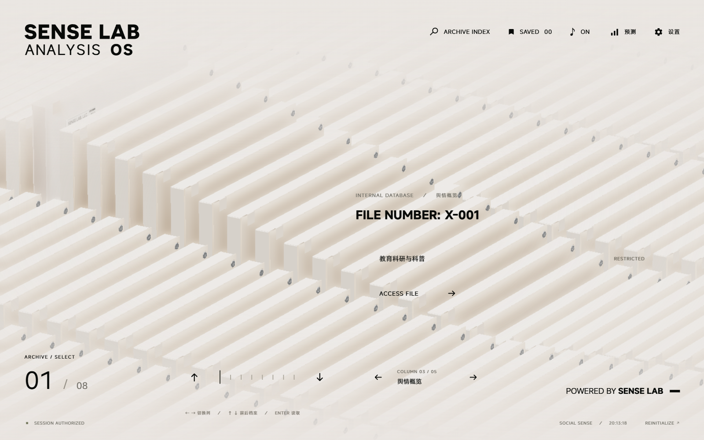
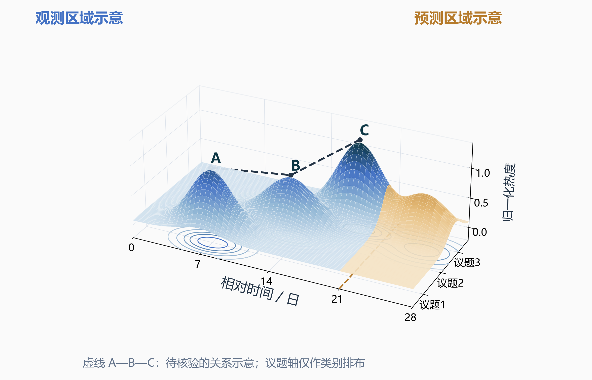
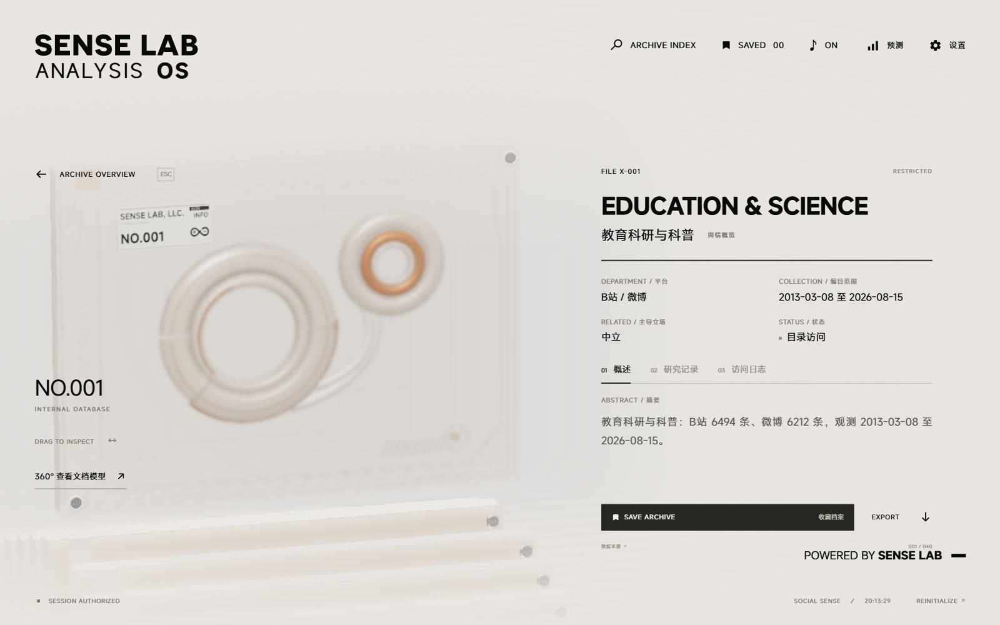

# SocialSense_中期答辩_第三页三栏修订版

- Source: `SocialSense_中期答辩_第三页三栏修订版.pptx`
- Total slides: 18

## Slide 1

创新训练类中期答辩

SocialSense
基于多源社交媒体协同的
舆情溯源与辅助预测系统

汇报人：张艺嘉

指导教师：树扬

成员：詹江叶煜 郑锦凡 王悦 吴珂欣

2026 年 11 月

### Speaker Notes

各位老师好，我是张艺嘉。SocialSense面向广泛社会舆情，研究路径溯源、未来走向预测和可视化呈现。下面汇报中期进展。

## Slide 2

研究价值：看清社会舆情的来源与走向

面向公共事件、文化娱乐与社会议题，连接传播证据、后续趋势和直观理解

来源：把讨论放回传播过程

仓库数据基础

面对多平台转载与观点交织，需要辨别信息出处、
关键节点和出现顺序，为事件复盘与公众沟通
提供可核查的线索，而非仅观察当前声量。

4 个平台

B站 · 微博 · 抖音 · 小红书

走向：关注变化是否持续

12 个主题域

社会事件可能持续发酵，文化内容也可能快速走红。
通过历史热度与事件信号探索后续变化，
为持续观察、回应安排和研究选题提供辅助判断。

社会法治、教育、文娱、科技等

49.6 万原始行

呈现：降低复杂数据的阅读成本

61个物理CSV；未去重计数
主题语料不等于事件级标注。

计划以三维山峰和等高线组织时间、议题与热度，
联动路径线索、预测区间及来源记录，
让研究者更直观地比较峰值、迁移与变化趋势。

来源：仓库原始数据与manifest

定位：广泛社会舆情研究；三维山峰图为下一阶段设计目标。

SocialSense · 创新训练类中期答辩

02 / 18

### Speaker Notes

我们的对象包括公共事件、文化娱乐和一般社会议题。需要回答的既有信息从哪里来、如何扩散，也有后续热度会怎样变化，以及如何直观理解复杂数据。仓库已有四个平台、十二个主题域的语料，约四十九点六万原始行，为研究提供基础；它们还需要整理成可验证的事件样本。

## Slide 3

应用场景：三类议题，共用同一技术框架

从消费争议到综艺走红、游戏社群，研究信息从何而来、如何扩散以及后续怎样变化

01 社会公共议题

02 文化娱乐传播

03 游戏社群互动

西贝“预制菜”争议

《后会友期》综艺

《明日方舟》梗传播

消费者知情权与品牌信任

内容走红与热度延续

积极传播与创作认可

个人发声与企业回应交织，
争论从菜品扩展至知情权、
定价与品牌信任，呈现多方
立场分歧与反复传播。

从节目话题到切片和二创，
观察内容如何跨平台扩散；
区分短时爆发、持续关注
与再次传播的不同阶段。

以“酸橙”相关二创为例，
连接素材分享、玩家改写
和跨圈传播，关注创作来源
与官方、玩家的互动反馈。

研究切入

研究切入

研究切入

核对原帖、回应和媒体转述；
比较平台立场与热度变化，
识别关键节点及再升温线索。

关联话题出处与扩散顺序；
结合历史热度预测后续变化，
辅助内容复盘与受众研究。

梳理原始表达、变体与引用；
观察传播热度和语境变化，
支持创作认可与社区沟通。

[报道：央广网](https://finance.cnr.cn/ycbd/20250915/t20250915_527362854.shtml)

[央视网](https://opinion.cctv.com/2026/03/03/ARTI9m58PmwiNfBHSBoNEoHL260303.shtml)

用户指定案例 · 事件样本待补齐

[素材分享](https://www.taptap.cn/moment/834126362733185189)

[创作征集](https://www.taptap.cn/moment/832223722998859956)

共同研究链路：路径溯源 → 热度走向预测 → 三维等高线与证据联动（规划）

案例用于说明应用需求；专项效果需事件样本验证，完整传播关系及三维山峰图仍需补齐。

SocialSense · 创新训练类中期答辩

03 / 18

### Speaker Notes

第三页展示三类不同传播：西贝预制菜争议涉及知情权、价格与信任，可用于观察发声、回应和再扩散；《后会友期》侧重综艺走红后的热度延续；明日方舟侧重梗的二创来源与官方、玩家互动。三者共用路径溯源、走向预测和可视化框架。这里展示的是应用需求，专项效果仍要以事件样本和后续验证为准。

## Slide 4

路径溯源：从平台先后走向传播关系核验

已实现报告契约、时间对齐和平台传播线索；逐条引用关系及完整路径还原仍需补齐

① 组织多源观测

⑤ 关系图与来源复核

② 平台最早观测与时延

平台、内容与发布时间
统一为 PlatformReport
保留原始ID和引用标识
对齐时间，标记缺失

下一步标注转载、引用边
区分直接证据与候选关联
追踪关键节点和路径变化
支持点击节点回看原文

first_seen / delay_hours

③ 峰值与日声量序列

peak_date / daily / total

作用：提供可追查的输入

状态：完整关系图待验证

④ 差异融合与结论校准

时间对齐解决比较口径；
语义同事件识别另需验证。

最早观测不是实际首发；
时延不能独立证明传播方向。

比较立场、情绪和声量，保留证据

研究价值：把“在哪个平台先出现、何时扩散”逐步连接到“由哪些内容和节点传播”。

代码依据：backend/app/routes/analysis.py · multiagent/contract.py / align.py / fuse.py

SocialSense · 创新训练类中期答辩

04 / 18

### Speaker Notes

路径溯源是项目的核心方向之一。目前代码已统一平台报告，完成时间对齐，并提供各平台最早观测时间、相对时延、峰值和日声量接口，可以帮助回看先后顺序。下一步要补充逐条转载和引用关系，将线索组织为可核查的传播路径。最早观测不等于实际首发，时间相关也不能单独证明传播方向。

## Slide 5

证据约束：让舆情判断保留依据与分歧

把来源核验、平台差异和不确定性纳入报告，支持公共事件与文化议题的人工复核

G1—G7：单平台结论与观测一致

原始观测与来源标识

核对趋势、情绪、立场、引用标识与数值边界，
检查空窗表述及风险判断是否有观测依据。
能暴露结构性矛盾；引用存在仍需核对内容支持。

形成候选分析结论

规则核验与受限改写

CX1—CX5：跨平台汇总保留差异

核对平台覆盖、分歧表述和引用平台的有效性，
每条断言绑定平台；全空数据不生成强结论。
不同平台的观点不被合并为单一、确定的叙述。

保留依据后再输出

目标：把判断连接到观测证据

应用价值：支持事件复盘、研究判断和有依据的沟通回应。

SocialSense · 创新训练类中期答辩

05 / 18

### Speaker Notes

无论公共事件还是文化议题，分析都要回到证据。单平台G规则核对趋势、情绪、立场、引用与数值边界，跨平台CX规则核对覆盖、分歧和断言的平台绑定。它们能暴露不一致，并保留复核依据；引用标识存在仍不代表内容支持结论，因此关键判断继续保留人工核验。

## Slide 6

未来走向预测：建模舆情热度的不同结构

对后续热度、方向与尖峰作辅助判断；事件事实及社会结果不由热度模型决定

分量专属编码

输入热度 x

线性 / PatchCNN / 稀疏事件 / 轻量 SSM；
分别处理长期、周期、冲击与其余波动。

x = T + S + C + R

数值表征参与稀疏路由

T 趋势

S 季节

C 冲击

R 剩余

默认 top-k = 2 选择专家；
分量与融合设计的收益需要消融实验检验。

EMA

Fourier

事件信号

代数剩余项

文本增量为可选路径

四路编码 → 稀疏专家融合

完整模型含门控文本分支；现有部署验证
关闭文本，文本收益需与数值结果分别评价。

预测增量 → 累加回水平域

过去 28 天 → 未来 6 天

评价覆盖误差与决策指标

辅助观察持续升温、回落与再次波动，
为后续跟踪和研究安排提供趋势线索。

下页保留 MSE、方向、尖峰及部署结果；
公共事件与文化内容须再做跨事件检验。

SocialSense · 创新训练类中期答辩

06 / 18

### Speaker Notes

未来走向在当前实现中主要指热度、方向和尖峰的辅助预测。模型把序列分为趋势、季节、冲击和剩余四路，分别编码后用稀疏专家融合，输入过去二十八天，预测未来六天。完整模型还有可选文本路径，数值部署验证关闭了文本；模型预测热度，并不替代对事件事实和社会结果的判断。

## Slide 7

实测结果：数值拟合与预警仍有提升空间

2026-10-19 CPU 数值路径验证；测试窗口 262 个

65.53%

标准化 log1p 空间 MSE

方向准确率

235 个非平坦窗口

> [Chart] mse-comparison — COLUMN_CLUSTERED (51)

| Category | MSE |
| --- | --- |
| 持续值 | 1.52464210987091 |
| 数值路径 | 1.88859081268311 |

0.610

尖峰 AUC

召回率 39.39% / 精确率 38.24%

预警阈值来自验证集，测试集仅用于评估

242.17 KiB

数值包 · 49,373 参数 · 262 窗口一致

文件体积不等于运行内存；重叠窗口不独立

较持续值基线高 23.87% · 误差尚未占优

SocialSense · 创新训练类中期答辩

07 / 18

### Speaker Notes

现有验证中，方向准确率为百分之六十五点五三，尖峰AUC为零点六一；但MSE比持续值基线高约百分之二十三点八七，说明误差仍需改进。精确率和召回率不足四成，也需继续评估预警价值。工程上，约二百四十二KiB的数值包在二百六十二个测试窗口与原数值路径输出一致。

## Slide 8

交互原型：从档案入口进入研究记录

本地仓库运行实拍 · 2026-10-29 · 内置档案数据

三维档案终端

浏览与检索议题档案
查看平台和观测范围
进入详情与研究记录

该截图证明前端交互已运行。
线上服务及数据链路仍需联调。

SocialSense · 创新训练类中期答辩

08 / 18

### Speaker Notes

这是已有三维档案界面的本地运行截图，用于浏览议题、查看平台范围和研究记录。代码还实现了二维历史与预测曲线。现有三维档案证明交互基础已经形成；接下来介绍的舆情等高线山峰图属于下一阶段设计，不能与这张实际界面截图混同。

## Slide 9

组合特色：溯源、预测与三维等高线

围绕同一事件连接传播线索、未来趋势与可视化；三维等高线山峰图尚未实现

路径：回看传播依据

点击节点回到原始记录，
核验引用、转载与候选关联。
已有基础：平台时序与来源标识。

设计示意 · 合成数据 · 未接入前端

预测：观察后续变化

在同一时间轴标明未来区域，
对照热度、方向和尖峰提示。
已有基础：数值模型与二维曲线。

视觉：呈现峰值与演变

用山峰高度和等高线比较热度，
支持旋转、筛选及二维投影。
规划目标：三维视图与证据联动。

组合优势需通过任务准确率与效率验证。

SocialSense · 创新训练类中期答辩

09 / 18

### Speaker Notes

我们希望形成的组合特色，是把路径溯源、未来预测和三维等高线呈现连接在同一事件中。这张图完全采用合成数据，并非实际系统截图：山峰和等高线帮助比较热度，虚线表示待核查的关系，另一颜色区分未来区域。计划点击节点回到证据、切换二维投影并联动预测。山峰图尚未实现，优势将通过判断正确率、定位耗时和运行表现来验证。

## Slide 10

中期进展：原型已成型，组合能力继续补齐

按代码与记录报告阶段成果；路径关系、跨事件预测与三维地形是下一阶段重点

01 多平台数据与校准

02 传播线索与路径溯源

已有4平台语料、报告契约及 G/CX 规则；
事件级标注、来源完整性和长期稳定性待补齐。

已有最早观测、平台时延、峰值及日序列接口；
逐条转载关系与完整传播路径仍需标注验证。

03 辅助预测与部署

04 三维交互与趋势呈现

已训练四分量模型并完成 CPU 数值包验证；
误差尚未优于持续值，跨事件与文本收益待测。

已有 Three.js 档案场景和二维预测曲线；
三维等高线山峰图及其联动交互尚未实现。

成员协作与验收材料

张艺嘉：架构、模型与联调 · 王悦：数据质量 · 郑锦凡：基线与误差分析

詹江叶煜：事件对齐与传播关系 · 吴珂欣：三维交互 · 共同交付：样本、评估表与试用记录

当前成果按原型和验证记录说明；论文、软著及正式验收状态以实际回执为准。

SocialSense · 创新训练类中期答辩

10 / 18

### Speaker Notes

中期已有多平台数据与校准、传播时序接口、四分量预测和交互原型。我们按成员分工推进数据质量、模型评估、传播关系与三维交互，以样本、评估表和试用记录验收。完整关系图、跨事件泛化以及等高线山峰图，是后半程需要补齐的重点。

## Slide 11

应用示例：游戏梗传播中的创作与互动

作为多类舆情场景之一，说明来源追溯与趋势观察如何支持积极传播和社区交流

理解积极传播的价值

角色、台词和共同经历成为可复用的表达，
带动二次创作与玩家交流。官方素材分享与
公开创作征集，展示了内容参与的实际场景。

把创作来源与传播线索连接起来

记录原始表达、改写与转载，核对作者和语境；
结合跨平台声量和立场变化，辅助发现创作贡献、
玩家诉求及适合进一步复核的传播节点。

让应用收益回到研究验证

可为创作认可、社区答疑与内容复盘提供依据；
同样的方法也服务公共事件和文化娱乐。
当前案例用于说明需求，尚非专门采集的实测。

[\[W2\] TapTap 创作征集活动原图](https://www.taptap.cn/moment/832223722998859956)

[\[W1\] 官方素材分享](https://www.taptap.cn/moment/834126362733185189)

[\[11\] 梗传播研究（IMC 2018）](https://arxiv.org/abs/1805.12512)

图片权利归原发布方；作为公开案例引用

SocialSense · 创新训练类中期答辩

11 / 18

### Speaker Notes

游戏梗传播只是其中一个应用例。公开创作征集展示了积极传播和玩家互动；来源线索可以辅助创作认可，平台差异和热度则支持内容复盘。它与公共事件、综艺传播共用项目能力，不能用某一垂直场景代替技术特色。这个案例仍是需求展示，尚未完成专项实测。

## Slide 12

下一阶段：验证路径、预测与可视化的联动

项目周期至 2027 年 6 月；以关系样本、统一实验和任务试用判断研究价值

2026.11—12

2027.01—03

2027.04—06

补齐事件与关系样本

完善预测与三维原型

验证使用价值与结题

扩展公共事件与综艺传播样本
核对原链接、时点与引用边
区分已知关系和仅时间关联
验收：标注说明、来源关系集

统一基线、滚动和跨事件评价
实现山峰图、等高线与预测分界
联动节点证据并支持二维投影
验收：误差分析、可运行演示

对照二维图开展定位与判断任务
测量正确率、耗时及运行性能
收敛已验证模块并整理成果
验收：试用记录、研究与结题材料

应用展望：为事件复盘、文化传播研究和组织沟通提供试点工具，先验证准确性、效率与可解释性。

申请书预算 7,500 元；实际获批、支出与调剂审批仍以财务记录核对。

优先支持数据标注、必要算力、可视化实现和研究成果整理，保持创新训练类定位。

SocialSense · 创新训练类中期答辩

12 / 18

### Speaker Notes

下一步先扩充公共事件与文化传播的关系标注，再开展统一基线、跨事件评价，并实现三维山峰图和证据联动。随后用相同任务对照二维和三维视图，检验准确性与效率。应用上探索事件复盘和传播研究工具，保持创新训练定位；申报预算七千五百元，实支和成果状态按凭证与回执核对。

## Slide 13

请各位老师指正

汇报人：张艺嘉 指导教师：树扬
成员：詹江叶煜 郑锦凡 王悦 吴珂欣

2026 年 11 月

### Speaker Notes

项目面向广泛社会舆情，已有研究原型，后续围绕路径、预测与三维可视化补齐验证。请各位老师指正。

## Slide 14

备份｜评价协议与误报漏报明细

数值路径：CPU / with_text=False / L=28 / P=6

标签阈值与报警阈值分别定义

数据与时间切分

报警：预测增量 > 验证集阈值 0.4694
标签：真实增量 > 测试集分位数 1.6922

1339 天：2023.01.01—2026.08.31
训练 / 验证 / 测试：937 / 135 / 267 天
测试窗口：262；方向有效窗口：235
仅训练段拟合 log1p 后的标准化器
方向排除真实变化幅度最低 10% 窗口
尖峰标签按测试集真实增量 q75 定义

|   | 真实尖峰 | 真实非尖峰 |
| --- | --- | --- |
| 报警 | 26 | 42 |
| 不报警 | 40 | 154 |

标签用于回溯评价，不是预先已知的尖峰标准。
窗口重叠，后续需滚动评估及分块置信区间。

SocialSense · 创新训练类中期答辩

14 / 18 备份

### Speaker Notes

实验按时间划分训练、验证和测试，标准化器仅在训练段拟合。报警阈值来自验证集预测增量，测试集分位数只用于定义回溯评价标签，二者不能混为一谈。二百六十二个测试窗口中，真正例二十六、假正例四十二、假负例四十、真负例一百五十四；窗口存在重叠，后续还需滚动评估和分块置信区间。

## Slide 15

备份｜文献启发与当前实现的边界

文献支持研究设计，不自动构成本项目的性能证据

DLinear / xPatch [3,4]

已实现 ≠ 已证明

分解、线性基线与 PatchCNN；项目扩展四分量路径。

框架与代码可检查
相对性能仍需统一基线
回音室需互动网络证据 [1]

Mamba / PELT [5,6]

选择性状态与变点建模；项目采用轻量实现与事件信号。

RAG / ReAct [7,10]

待完成的验证

外部证据与行动反馈；项目以契约和规则约束生成。

分量 / 文本 / 路由消融
跨话题与滚动时间评估
传播关系与标注样本 [2]

Time-LLM 与消融研究 [8,9]

文本或大模型的价值必须独立消融，不能先验假定。

SocialSense · 创新训练类中期答辩

15 / 18 备份

### Speaker Notes

我们从分解预测研究中借鉴分量建模，从Mamba借鉴选择性状态思想，从RAG和ReAct借鉴外部证据与行动反馈。项目当前采用轻量实现和规则契约，不能直接引用原论文的性能作为本项目成绩。对文本路径、专家路由和传播解释的价值，需要各自补充消融与人工标注检验。

## Slide 16

备份｜详情界面保留来源与观测范围

本地运行实拍 · 仓库内置档案数据 · 非线上实时抓取证明

可检查的入口

平台 / 来源
观测时间范围
摘要与主导立场
研究记录与访问日志
截图内条数属于该档案，
不等于预测实验样本量。

SocialSense · 创新训练类中期答辩

16 / 18 备份

### Speaker Notes

详情页显示平台、观测范围、摘要、立场以及研究记录入口。该页面来自仓库本地运行的内置档案，其中展示的条数属于该档案，不能替代预测实验的一千三百三十九个日度观测口径。下一步需将界面字段与后端证据索引逐项核对。

## Slide 17

备份｜经费按申请预算列示，实支待核账

材料依据：立项申请书预算；原草稿调整建议尚缺审批与票据

| 原预算科目 | 金额 / 元 |
| --- | --- |
| 云服务器 | 1,800 |
| 数据采集与接口 | 1,200 |
| 软件开发与模型训练 | 2,000 |
| 大模型调用 | 1,000 |
| 调研差旅 | 800 |
| 知识产权及论文 | 700 |
| 合计 | 7,500 |

下一步核对

获批额度与实际到账
逐笔支出、账单和凭证编号
预算科目与调剂审批
原草稿提出调用费增至 2200 元，
目前仅按调整建议记录。
不据此计算执行率与结余。

SocialSense · 创新训练类中期答辩

17 / 18 备份

### Speaker Notes

这里列示的是立项申请书的六类预算，总额七千五百元。原草稿提出的费用调剂目前按建议记录，尚缺审批与支出票据，因此不把预算等同于实际花费。负责人将按实际到账、逐笔支出、凭证和调整审批完善台账。

## Slide 18

备份｜参考文献与仓库证据入口

文献支持传播与预测方法；功能完成度和模型成绩以仓库代码、数据与验证记录为依据

[1] Cinelli et al. (2020, preprint)

[7] Lewis et al. (NeurIPS 2020)

Echo Chambers on Social Media: A comparative
analysis · arXiv:2004.09603

Retrieval-Augmented Generation for
Knowledge-Intensive NLP Tasks · 2005.11401

[2] Zannettou et al. (2017)

[8] Jin et al. (ICLR 2024)

The Web Centipede · arXiv:1705.06947

Time-LLM · arXiv:2310.01728

[3] Zeng et al. (AAAI 2023)

[9] Tan et al. (NeurIPS 2024)

Are Transformers Effective for Time Series
Forecasting? · arXiv:2205.13504

Are Language Models Actually Useful for
Time Series Forecasting? · 2406.16964

[4] Stitsyuk & Choi (2024, preprint)

[10] Yao et al. (ICLR 2023)

xPatch · arXiv:2412.17323

ReAct · arXiv:2210.03629

[5] Gu & Dao (2023, preprint)

[11] Zannettou et al. (IMC 2018)

Mamba · arXiv:2312.00752

On the Origins of Memes by Means of Fringe
Web Communities · arXiv:1805.12512

[6] Killick et al. (2011, preprint)

[W1 官方素材分享](https://www.taptap.cn/moment/834126362733185189)

[W2 创作征集](https://www.taptap.cn/moment/832223722998859956)

Optimal detection of changepoints with a linear
computational cost · arXiv:1101.1438

仅作为第11页案例来源；三维图见本轮设计说明。

代码与数据核验：docs/social_scope_20261109/CODE_EVIDENCE.md · 实测：retrain_20261019/deployment_verification.json

SocialSense · 创新训练类中期答辩

18 / 18 备份

### Speaker Notes

文献解释方法选择，功能完成度由代码核查，性能由本项目实验判断。本轮还保存了案例关键词检索口径和三维示意图说明，避免将原始语料、事件实测和规划效果混为一谈。
